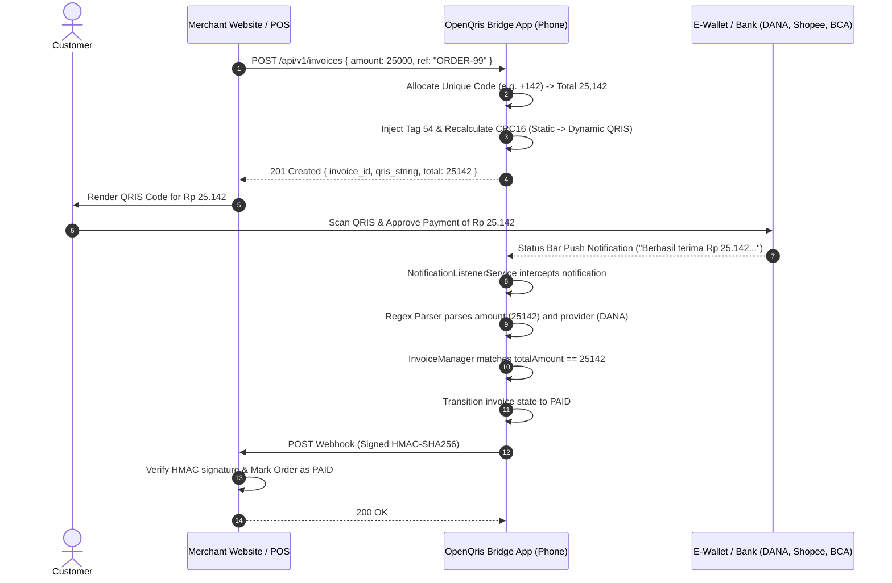

# OpenQris Bridge - Architecture & System Design

OpenQris Bridge turns any Android or iOS device into a self-hosted, zero-fee payment gateway bridge for Indonesian QRIS and e-wallet transfers.

## High-Level Architecture

```
+-----------------------------------------------------------------------------------+
|                              Customer Transaction Flow                            |
|                                                                                   |
|  1. Website / POS        2. OpenQris Bridge (Phone)      3. Customer Bank / Wallet|
|  Creates Order 25k  --->  Allocates Unique Code (142)    Scans QRIS Dinamis       |
|                           Dynamic Tag 54 Injection --->  Transfers Rp 25.142      |
|                                                                 |                 |
|                                                                 v                 |
|  4. Merchant Website     5. Android / iOS Bridge <--- 4. Push Notification        |
|  Receives Webhook   <---  Regex Parser extracts 25.142    (DANA / Shopee / BCA)   |
|  Order Status: PAID       Matches INV-20261106-001                                |
+-----------------------------------------------------------------------------------+
```

## Detailed Flow Diagram



## Key Components

1. **EMVCo QRIS Engine (`lib/core/emvco/`)**
   - Parses EMVCo Tag-Length-Value (TLV) payload.
   - Calculates CRC16-CCITT with polynomial 0x1021.
   - Transforms Static QRIS (Point of Initiation Method `11`) into Dynamic QRIS (`12`) by injecting Tag 54 (Transaction Amount) and Tag 62 (Bill Number).

2. **Regex Notification Parser Engine (`lib/core/parsers/`)**
   - Pre-configured parsers for Indonesian financial apps:
     - DANA (`id.dana`)
     - Shopee / ShopeePay (`com.shopee.id`)
     - GoPay / GoBiz (`com.gojek.app`, `com.gobiz`)
     - OVO (`ovo.id`)
     - BCA Mobile / myBCA / SMS (`com.bca`)
     - Bank Mandiri Livin (`id.co.bankmandiri.livin`)
     - Bank BRI BRImo (`id.co.bri.brimo`)
     - SeaBank (`com.seabank.id`)
   - Sanitizes Indonesian currency formats (`Rp 25.142`, `Rp25.142,00`, `CR 25.142,00`).
   - Dynamic user-defined custom regex rule system.

3. **Unique Code & Invoice Manager (`lib/core/manager/`)**
   - Allocates unique identifiers to distinguish transactions when multiple orders exist.
   - Strategies: Random (+1..999), Sequential (+1, +2...), Discount (-1..-999), None (0).
   - Collision detection against active pending invoice totals.
   - Auto-expiry cleanup loop releasing codes after timeout.

4. **Embedded Local Server (`lib/core/server/`)**
   - Runs a native Shelf HTTP server on the phone (`http://<phone-ip>:8080`).
   - REST API endpoints for POS systems, websites, or bots.
   - Real-time WebSocket event broadcaster (`/ws`).

5. **Webhook Dispatcher (`lib/services/`)**
   - Dispatches HTTP POST notifications with exponential backoff retries.
   - Signs requests with HMAC-SHA256 headers (`X-Signature`, `X-Timestamp`, `X-Event`).
   - Delivery log tracker.

6. **Native Android & iOS Bridge (`android/`, `ios/`)**
   - Android Kotlin `NotificationListenerService` and `BridgeForegroundService`.
   - Android `SmsReceiver` for SMS banking.
   - iOS URL scheme handler (`qrisbridge://`) and background task support.
